# BÁO CÁO MỤC 3: PHƯƠNG PHÁP VÀ KẾT QUẢ MÔ HÌNH BASELINE (CNN + LSTM/GRU)
**Hạng mục:** T24 – Viết phần Baseline CNN + LSTM/GRU trong Báo cáo chung  
**Thành viên phụ trách:** Nguyễn Xuân Quy (Mã B)  
**Phối hợp:** Nguyễn Ngọc Như Hiếu (Mã A – Dữ liệu & Tiền xử lý), Phạm Thị Thùy Linh (Mã C – Mô hình Video Pretrained), Nguyễn Thị Thuận Thiên (Mã D – Đánh giá, Demo & Gộp báo cáo)

---

## 3.1. Tổng quan phương pháp và lý do lựa chọn kiến trúc Baseline

Trong bài toán phát hiện hành vi bạo lực trên video (*Video Violence Detection*), hành vi bạo lực không chỉ nằm ở diện mạo tĩnh của một khung hình đơn lẻ mà biểu hiện chủ yếu qua **chuyển động cục bộ, tương tác va chạm tốc độ cao giữa các đối tượng và biến thiên tư thế theo thời gian**. Một mô hình mạng tích chập hai chiều (2D CNN) chỉ xem xét từng khung hình độc lập thường dễ nhầm lẫn giữa cảnh sinh hoạt đông người với cảnh xô xát, hoặc bỏ sót các pha ra đòn diễn ra nhanh trong vài phần mười giây. Ngược lại, các mô hình không-thời gian nguyên khối (như 3D CNN hay Video Transformer) có chi phí tính toán lớn và đòi hỏi bộ nhớ GPU cao.

Vì vậy, ở nhánh **Mô hình cơ sở (Baseline – T08, T09, T10)**, nhóm xây dựng kiến trúc hai giai đoạn kết hợp mạng tích chập tiền huấn luyện **MobileNetV2** (trích xuất đặc trưng không gian từng khung hình) với mạng hồi quy có cổng **LSTM / GRU** (mô hình hóa chuỗi quan hệ thời gian giữa $T$ khung hình liên tiếp). Hướng tiếp cận này đóng vai trò mốc tham chiếu chuẩn (*strong baseline*) để đối sánh công bằng về cả **độ chính xác nhận diện (ưu tiên Recall lớp Violence và F1-Score)** lẫn **chi phí tính toán, dung lượng bộ nhớ và tốc độ suy luận thực tế** với nhánh mô hình Video Pretrained của thành viên C (Phạm Thị Thùy Linh) và nhánh Zero-shot CLIP/X-CLIP của thành viên D (Nguyễn Thị Thuận Thiên).

### Lý giải lựa chọn mạng xương sống `MobileNetV2` (Pretrained ImageNet)
Thay vì sử dụng các mạng 2D CNN nặng như ResNet-50 (~25.6 triệu tham số) hay VGG-16 (~138 triệu tham số), nhóm lựa chọn **MobileNetV2** (`IMAGENET1K_V1` tiền huấn luyện trên tập ImageNet-1K) làm bộ trích xuất đặc trưng không gian cố định (*frozen spatial feature extractor*) vì 4 lý do kỹ thuật cốt lõi:
1. **Kiến trúc Tích chập tách chiều sâu (*Depthwise Separable Convolution*) và Khối nghịch đảo phần dư (*Inverted Residuals with Linear Bottlenecks*):** MobileNetV2 tách phép tích chập tiêu chuẩn thành hai bước: *Depthwise Convolution* ($3 \times 3$) lọc đặc trưng trên từng kênh riêng biệt và *Pointwise Convolution* ($1 \times 1$) tổ hợp tuyến tính các kênh. Cơ chế này giảm số phép nhân-cộng (MACs) từ $8$ đến $9$ lần so với tích chập thông thường mà vẫn giữ được biểu diễn hình học giàu ngữ nghĩa ở không gian chiều cao.
2. **Dung lượng siêu nhẹ và tốc độ suy luận thời gian thực cho Demo (T22):** Phần xương sống `MobileNetV2` sau khi loại bỏ lớp phân loại cuối chỉ chứa **2.223.872 tham số** (~**8,48 MB** trọng số `float32`; toàn mạng gốc bao gồm cả lớp classifier là ~3,4 triệu tham số). Khi chạy suy luận cho một video gồm $T=16$ khung hình trên GPU RTX 3050, thời gian lan truyền qua `MobileNetV2` chỉ mất trung bình **52,67 ms/video** (~3,29 ms/frame), đáp ứng xuất sắc yêu cầu phản hồi tức thì trên giao diện Gradio/Streamlit (`demo.py` – Gate G4).
3. **Chống hiện tượng quá khớp (*Overfitting*) trên tập dữ liệu quy mô vừa:** Bộ dữ liệu RLVS sau khi làm sạch có **1.391 video huấn luyện**. Nếu mở khóa huấn luyện (*fine-tune*) hàng chục triệu tham số của backbone 2D CNN trực tiếp trên 1.391 video, mô hình rất dễ học vẹt bối cảnh nền (màu sắc tường, góc máy, độ nén). Việc đóng băng (`requires_grad = False`) toàn bộ `MobileNetV2` và lưu bộ nhớ đệm (*feature caching*) vector đặc trưng $1280$ chiều cho từng khung hình giúp nhánh mạng tuần tự `LSTM / GRU` hội tụ nhanh, ổn định và chỉ cần huấn luyện khoảng **541 nghìn tham số**.
4. **Vector biểu diễn toàn cục $1280$ chiều giàu thông tin:** Ngay trước lớp phân loại của MobileNetV2, bản đồ đặc trưng không gian kích thước $(1280, 7, 7)$ đi qua tầng gom trung bình toàn cục `AdaptiveAvgPool2d((1, 1))` và làm phẳng (`Flatten`), tạo ra vector đặc trưng $\mathbf{f}_t \in \mathbb{R}^{1280}$ cho mỗi khung hình thứ $t$, mã hóa cô đọng tư thế đám đông, cử chỉ tay chân và bố cục cảnh quay.

---

## 3.2. Sơ đồ kiến trúc mô hình Baseline và Luồng xử lý toán học

Sơ đồ dưới đây mô tả chi tiết luồng xử lý đầu-cuối (*end-to-end pipeline*) của mô hình Baseline từ chuỗi khung hình đầu vào đến xác suất dự đoán bạo lực $y_{\text{prob}} \in [0, 1]$:

```mermaid
flowchart LR
    subgraph G1["1. Tiền xử lý & Chuẩn hóa (preprocess_utils.py)"]
        A["Video đầu vào / File .npy<br/>Trích đều T khung hình RGB<br/>Kích thước: (T, 224, 224, 3) uint8"] --> B["Chuẩn hóa ImageNet (to_torch_layout)<br/>Chia 255.0; trừ Mean [0.485, 0.456, 0.406]<br/>Chia Std [0.229, 0.224, 0.225]<br/>Tensor: (T, 3, 224, 224) float32"]
    end

    subgraph G2["2. Trích đặc trưng không gian (T08 - MobileNetV2 Frozen)"]
        B --> C["MobileNetV2 Backbone<br/>(Pretrained ImageNet-1K, đóng băng)<br/>17 khối Inverted Residual<br/>Bản đồ đặc trưng: (T, 1280, 7, 7)"]
        C --> D["Global Average Pooling<br/>AdaptiveAvgPool2d(1, 1) + Flatten<br/>Chuỗi vector đặc trưng X:<br/>Kích thước: (T, 1280) float32"]
    end

    subgraph G3["3. Mô hình hóa chuỗi thời gian (T09 - LSTM / GRU)"]
        D --> E["Mạng hồi quy tuần tự<br/>GRU hoặc LSTM (1–2 lớp)<br/>Hidden size H ∈ {128, 256}<br/>Trạng thái ẩn: (T, H)"]
        E --> F["Lấy trạng thái bước cuối h_T<br/>Vector ngữ cảnh động học:<br/>Kích thước: (H,)"]
    end

    subgraph G4["4. Phân loại nhị phân (Classifier Head)"]
        F --> G["Dropout (p = 0.3)<br/>+ Linear (H → 1)<br/>+ Hàm kích hoạt Sigmoid"]
        G --> H["Xác suất bạo lực y_prob ∈ [0, 1]<br/>So ngưỡng τ = 0.50:<br/>1 = Violence | 0 = NonViolence"]
    end
```

### Diễn giải chi tiết từng bước trong luồng xử lý
1. **Trích xuất khung hình cách đều và Chuẩn hóa ImageNet (`preprocess.py` & `preprocess_utils.py`):**
   - Từ một video có tổng cộng $L$ khung hình, hệ thống lấy mẫu $T$ chỉ số khung hình cách đều nhau trên toàn bộ thời lượng video theo công thức:
     $$i_t = \text{round}\left(\frac{t - 1}{T - 1} \cdot (L - 1)\right), \quad t \in \{1, 2, \dots, T\}$$
     Với cấu hình chuẩn $T = 16$ (và các biến thể $T \in \{8, 20\}$ trong thí nghiệm Ablation T10), cách lấy mẫu trải đều toàn video giúp mô hình nắm bắt trọn vẹn diễn biến trước, trong và sau khi xảy ra xô xát.
   - Mỗi khung hình được đổi hệ màu từ BGR sang RGB, nội suy về kích thước chuẩn $224 \times 224$ bằng thuật toán `cv2.INTER_AREA` (chống răng cưa khi thu nhỏ khung hình độ phân giải cao), lưu dưới dạng mảng `uint8` kích thước $(T, 224, 224, 3)$.
   - Khi nạp vào mô hình, hàm `to_torch_layout(frames_uint8)` chuyển đổi giá trị điểm ảnh sang `float32` trong đoạn $[0, 1]$, chuẩn hóa theo từng kênh màu RGB của ImageNet ($\mu = [0.485, 0.456, 0.406]$, $\sigma = [0.229, 0.224, 0.225]$) và hoán vị chiều về định dạng chuẩn PyTorch $(T, 3, 224, 224)$.

2. **Trích xuất đặc trưng không gian bằng `MobileNetV2` (`extract_features.py` – T08):**
   - Mỗi khung hình chuẩn hóa $\mathbf{I}_t \in \mathbb{R}^{3 \times 224 \times 224}$ đi qua phần thân tích chập `backbone.features` của MobileNetV2, thu được tensor đặc trưng $(1280, 7, 7)$.
   - Qua tầng gom trung bình toàn cục `AdaptiveAvgPool2d((1, 1))` và làm phẳng `Flatten`, mỗi khung hình trở thành một vector đặc trưng $\mathbf{x}_t \in \mathbb{R}^{1280}$. Toàn bộ video được biểu diễn thành ma trận chuỗi đặc trưng $\mathbf{X} = [\mathbf{x}_1, \mathbf{x}_2, \dots, \mathbf{x}_T]^\top \in \mathbb{R}^{T \times 1280}$ và lưu vào thư mục `features/` dưới dạng cả file `.npy` từng video lẫn gói nén tốc độ cao `.npz` (`features_n8.npz`, `features_n16.npz`, `features_n20.npz`).

3. **Mô hình hóa động học thời gian bằng `GRU` / `LSTM` (`train_baseline.py` – T09):**
   - Chuỗi đặc trưng $\mathbf{X} \in \mathbb{R}^{B \times T \times 1280}$ (với $B$ là kích thước batch) được đưa vào mạng tuần tự **GRU** (*Gated Recurrent Unit*) hoặc **LSTM** (*Long Short-Term Memory*) có kích thước ẩn $H \in \{128, 256\}$ và số lớp $L_{\text{rnn}} \in \{1, 2\}$.
   - Với **GRU**, tại mỗi bước thời gian $t \in \{1, \dots, T\}$, trạng thái ẩn $\mathbf{h}_t \in \mathbb{R}^H$ được cập nhật thông qua cổng cập nhật (*update gate*) $\mathbf{z}_t$ và cổng xóa (*reset gate*) $\mathbf{r}_t$:
     $$\mathbf{z}_t = \sigma(\mathbf{W}_z \mathbf{x}_t + \mathbf{U}_z \mathbf{h}_{t-1} + \mathbf{b}_z), \quad \mathbf{r}_t = \sigma(\mathbf{W}_r \mathbf{x}_t + \mathbf{U}_r \mathbf{h}_{t-1} + \mathbf{b}_r)$$
     $$\tilde{\mathbf{h}}_t = \tanh(\mathbf{W}_h \mathbf{x}_t + \mathbf{U}_h (\mathbf{r}_t \odot \mathbf{h}_{t-1}) + \mathbf{b}_h), \quad \mathbf{h}_t = (1 - \mathbf{z}_t) \odot \mathbf{h}_{t-1} + \mathbf{z}_t \odot \tilde{\mathbf{h}}_t$$
   - Trạng thái ẩn ở bước thời gian cuối cùng $\mathbf{h}_T \in \mathbb{R}^H$ tổng hợp toàn bộ thông tin chuyển động tích lũy từ đầu đến cuối video.

4. **Đầu phân loại nhị phân (*Classifier Head*):**
   - Vector $\mathbf{h}_T$ đi qua tầng `Dropout(p = 0.3)` để giảm đồng thích nghi giữa các nơ-ron, tiếp nối bởi tầng tuyến tính `Linear(H, 1)` và hàm kích hoạt `Sigmoid`:
     $$y_{\text{prob}} = \sigma(\mathbf{w}^\top \text{Dropout}(\mathbf{h}_T) + b) \in (0, 1)$$
   - Nhãn dự đoán nhị phân được xác định theo ngưỡng quyết định $\tau$ (mặc định $\tau = 0.50$ theo quy ước thống nhất với thành viên D):
     $$y_{\text{pred}} = \mathbb{I}(y_{\text{prob}} \ge \tau) \in \{0\text{ (NonViolence)}, 1\text{ (Violence)}\}$$

---

## 3.3. Thiết lập thực nghiệm (Experimental Setup)

Toàn bộ quy trình huấn luyện và đánh giá tuân thủ nghiêm ngặt quy tắc chống rò rỉ dữ liệu (*Data Leakage Prevention*) đã thống nhất ở Giai đoạn G0 & G1:

### 1. Phân chia dữ liệu chuẩn (`splits.csv` và `cross_test.csv` của Hiếu – Mã A)
| Tập dữ liệu | Nguồn gốc | Tổng số video | Lớp `NonViolence` (`label=0`) | Lớp `Violence` (`label=1`) | Vai trò trong thực nghiệm |
|---|---|---:|---:|---:|---|
| **RLVS `train`** | Real Life Violence Situations | **1.391** (70,0%) | 696 | 695 | Huấn luyện trọng số nhánh mạng tuần tự LSTM/GRU |
| **RLVS `val`** | Real Life Violence Situations | **298** (15,0%) | 149 | 149 | Dừng sớm (*Early Stopping*), chọn cấu hình Ablation tốt nhất và kiểm tra ngưỡng |
| **RLVS `test`** | Real Life Violence Situations | **297** (15,0%) | 149 | 148 | Đánh giá độc lập nội phân phối (T19 – tuyệt đối không dùng để chọn mô hình) |
| **Tổng RLVS** | *Sau khi loại 14 video trùng MD5* | **1.986** (100%) | **994** | **992** | Chia phân tầng (*stratified*) theo video với `seed = 42` |
| **RWF-2000 `cross_test`** | Camera giám sát thực tế (ICPR 2020) | **400** | 200 (`rwf_N_*`) | 200 (`rwf_F_*`) | Đánh giá khả năng tổng quát hóa ngoài phân phối (*Out-of-Distribution* – T20) |

> [!IMPORTANT]
> **Quy tắc kiểm soát rò rỉ dữ liệu và chọn siêu tham số:**  
> Mọi quyết định lựa chọn kiến trúc (`GRU` vs `LSTM`), số khung hình ($T$), kích thước ẩn ($H$), thời điểm dừng sớm (*checkpoint* tốt nhất) và ngưỡng phân loại đều **chỉ được thực hiện trên tập `val` RLVS (298 video)**. Tập `test` RLVS (297 video) và tập `cross_test` RWF-2000 (400 video) chỉ được chạy suy luận đúng một lần từ checkpoint đã khóa để báo cáo khách quan.

### 2. Cấu hình huấn luyện và Siêu tham số (T09)
- **Hàm mất mát (*Loss Function*):** Binary Cross-Entropy Loss (`nn.BCELoss`), có kẹp xác suất an toàn $y_{\text{prob}} \in [10^{-7}, 1 - 10^{-7}]$ để tránh tràn số $\log(0)$.
- **Thuật toán tối ưu (*Optimizer*):** Adam với tốc độ học khởi tạo $\text{lr} = 10^{-3}$ và hệ số suy giảm trọng số $\text{weight\_decay} = 10^{-4}$ (L2 regularization).
- **Điều chỉnh tốc độ học (*LR Scheduler*):** `ReduceLROnPlateau(mode="min", factor=0.5, patience=3)` tự động giảm một nửa tốc độ học khi `val_loss` không giảm sau 3 epoch.
- **Cơ chế dừng sớm (*Early Stopping*) và chọn Checkpoint:** Huấn luyện tối đa `30 epochs` với `batch_size = 32`, `patience = 7 epochs`. Checkpoint được lưu tại epoch đạt tổng điểm `Val F1` cao nhất và `Val BCE Loss` thấp nhất.
- **Tái lập kết quả (*Reproducibility*):** Cố định hạt giống ngẫu nhiên `seed = 42` trên toàn bộ `numpy`, `random`, `torch` và `torch.cuda`.
- **Môi trường phần cứng:** GPU NVIDIA GeForce RTX 3050 (CUDA) kết hợp bộ nhớ đệm đặc trưng `.npz` giúp huấn luyện toàn bộ 10 cấu hình biến thể và thí nghiệm tăng cường dữ liệu chỉ trong vài phút.

---

## 3.4. Quá trình huấn luyện mô hình Baseline tốt nhất (T09)

Cấu hình đạt hiệu năng cao nhất trên tập Validation là **`C05_GRU_T16_H128_L1`** (**GRU 1 lớp, $T = 16$ khung hình, `hidden_size = 128`, `dropout = 0.3`**), hội tụ và đạt đỉnh tại **Epoch 15** với:
- **`Val BCE Loss` thấp nhất:** `0.0517`
- **`Val Accuracy`:** `0.9832` (98,32%)
- **`Val Precision`:** `0.9737` (97,37%)
- **`Val Recall (Violence)`:** `0.9933` (99,33% – phát hiện đúng 148/149 video bạo lực trên tập Val)
- **`Val F1-Score`:** `0.9834` (98,34%)
- **`Val ROC-AUC`:** `0.9986` (99,86%)

*(Lưu ý về ngưỡng quyết định: Trên tập `val`, nếu tinh chỉnh ngưỡng xác suất lên $\tau^* = 0.52$, mô hình loại bỏ thêm 1 ca dương tính giả ở ranh giới (`NV_476` có $y_{\text{prob}} = 0.5189$) và đạt `Val F1 = 0.9867`, `Val Recall = 0.9933`. Để đảm bảo tính nhất quán tuyệt đối với quy ước chung của nhóm trong bảng chốt kỹ thuật với Thiên D, toàn bộ các file dự đoán `preds_baseline*.csv` sử dụng ngưỡng chuẩn $\tau = 0.50$).*

### Phân tích biểu đồ đường cong huấn luyện (`loss_curve.png`)

*Hình 3.1: Biểu đồ đường cong hàm mất mát BCE Loss và các chỉ số đánh giá trên tập Validation theo Epoch ([loss_curve.png](file:///c:/Thị giác máy tính/Công việc/T08-T09/loss_curve.png)).*

Quan sát Hình 3.1 (`loss_curve.png`), quá trình học của mạng `GRU (T=16, H=128)` thể hiện 3 giai đoạn rõ rệt:
1. **Giai đoạn hội tụ nhanh (Epoch 1 – 5):** Nhờ đặc trưng không gian $1280$ chiều từ `MobileNetV2` đã phân tách tốt cấu trúc thị giác, `Train BCE Loss` giảm mạnh từ ~`0.52` xuống dưới `0.12`, đồng thời `Val F1-Score` nhanh chóng vượt mốc `0.95`.
2. **Giai đoạn tinh chỉnh động học chuỗi (Epoch 6 – 15):** Mạng GRU tinh chỉnh trọng số các cổng cập nhật và cổng xóa để phân biệt các chuyển động kéo dài qua 16 khung hình. Tại **Epoch 15** (vạch đỏ đứt nét trên đồ thị), `Val BCE Loss` chạm đáy **`0.0517`** và `Val F1` đạt đỉnh **`0.9834`** (`Val Recall = 0.9933`).
3. **Giai đoạn bão hòa và dừng sớm (Epoch 16 – 22):** Sau Epoch 15, `Train Loss` tiếp tục giảm nhẹ về gần `0.01` trong khi `Val Loss` dao động quanh `0.052 – 0.065` và không giảm thêm. Cơ chế *Early Stopping* tự động kích hoạt sau 7 epoch kiên nhẫn và khôi phục chính xác bộ trọng số tại **Epoch 15** lưu vào [baseline.pt](file:///c:/Thị giác máy tính/Công việc/T08-T09/baseline.pt), ngăn chặn triệt để hiện tượng quá khớp.

---

## 3.5. Thí nghiệm biến thể – Ablation Study (T10)

Để khảo sát toàn diện ảnh hưởng của từng thành phần kiến trúc và siêu tham số chuỗi thời gian (vượt mức yêu cầu tối thiểu 6 cấu hình của đề cương), nhóm tiến hành huấn luyện và đánh giá **10 cấu hình biến thể** trải rộng trên 4 chiều:
- **Số lượng khung hình trích xuất mỗi video:** $T \in \{8, 16, 20\}$ (tương ứng với 3 bộ đặc trưng `features_n8.npz`, `features_n16.npz`, `features_n20.npz`).
- **Kiến trúc tế bào hồi quy:** `LSTM` so với `GRU`.
- **Kích thước vector trạng thái ẩn (`hidden_size`):** $H \in \{128, 256\}$.
- **Độ sâu mạng tuần tự (`num_layers`):** $1$ lớp so với $2$ lớp chồng nhau (kèm Dropout giữa các lớp).

### Bảng 3.1: Kết quả Thí nghiệm biến thể (Ablation Study) trên tập Validation RLVS (Chuẩn cột thống nhất với Thiên – Mã D)
*(Số liệu trích xuất trực tiếp từ file [ablation_baseline.csv](file:///c:/Thị giác máy tính/Công việc/T08-T09/ablation_baseline.csv))*

| Mã cấu hình | Mô hình (LSTM/GRU) | Số frame (T) | Hidden size | Accuracy | Precision | Recall (Violence) | F1 | ROC-AUC |
|---|---|---:|---:|---:|---:|---:|---:|---:|
| `C01_LSTM_T8_H128_L1` | LSTM | 8 | 128 | 0.9631 | 0.9539 | 0.9732 | 0.9635 | 0.9957 |
| `C02_LSTM_T8_H256_L1` | LSTM | 8 | 256 | 0.9664 | 0.9484 | 0.9866 | 0.9671 | 0.9950 |
| `C03_GRU_T8_H256_L1` | GRU | 8 | 256 | 0.9664 | 0.9728 | 0.9597 | 0.9662 | 0.9951 |
| `C04_LSTM_T16_H128_L1` | LSTM | 16 | 128 | 0.9732 | 0.9608 | 0.9866 | 0.9735 | 0.9964 |
| **`C05_GRU_T16_H128_L1` (Tốt nhất)** | **GRU** | **16** | **128** | **0.9832** | **0.9737** | **0.9933** | **0.9834** | **0.9986** |
| `C06_LSTM_T16_H256_L1` | LSTM | 16 | 256 | 0.9732 | 0.9732 | 0.9732 | 0.9732 | 0.9962 |
| `C07_GRU_T16_H256_L1` | GRU | 16 | 256 | 0.9732 | 0.9548 | 0.9933 | 0.9737 | 0.9973 |
| `C08_LSTM_T16_H256_L2` | LSTM (2 lớp) | 16 | 256 | 0.9732 | 0.9608 | 0.9866 | 0.9735 | 0.9964 |
| `C09_LSTM_T20_H256_L1` | LSTM | 20 | 256 | 0.9664 | 0.9427 | 0.9933 | 0.9673 | 0.9963 |
| `C10_GRU_T20_H256_L2` | GRU (2 lớp) | 20 | 256 | 0.9732 | 0.9608 | 0.9866 | 0.9735 | 0.9970 |

### Bảng 3.2: Bảng mở rộng đối chiếu Val Loss, Tập Test RLVS và Tập Cross-Test RWF-2000 của 10 cấu hình Ablation

| Mã cấu hình | Mô hình | $T$ | $H$ | Lớp | Val Loss | Val F1 | Test Acc | Test Recall | Test F1 | Test AUC | Cross Acc | Cross Recall | Cross F1 | Cross AUC |
|---|---|---:|---:|---:|---:|---:|---:|---:|---:|---:|---:|---:|---:|---:|
| `C01_LSTM_T8_H128_L1` | LSTM | 8 | 128 | 1 | 0.1295 | 0.9635 | 0.9697 | 0.9662 | 0.9695 | 0.9976 | 0.5500 | 0.6700 | 0.5982 | 0.6271 |
| `C02_LSTM_T8_H256_L1` | LSTM | 8 | 256 | 1 | 0.1188 | 0.9671 | 0.9630 | 0.9797 | 0.9635 | 0.9964 | 0.5400 | 0.7950 | 0.6335 | 0.6403 |
| `C03_GRU_T8_H256_L1` | GRU | 8 | 256 | 1 | 0.0980 | 0.9662 | 0.9764 | 0.9662 | 0.9761 | 0.9973 | 0.6000 | 0.6450 | 0.6172 | 0.6712 |
| `C04_LSTM_T16_H128_L1` | LSTM | 16 | 128 | 1 | 0.0841 | 0.9735 | 0.9764 | 0.9730 | 0.9763 | 0.9967 | 0.5175 | 0.6700 | 0.5813 | 0.6144 |
| **`C05_GRU_T16_H128_L1`** | **GRU** | **16** | **128** | **1** | **0.0517** | **0.9834** | **0.9764** | **0.9797** | **0.9764** | **0.9977** | **0.5550** | **0.7500** | **0.6276** | **0.6514** |
| `C06_LSTM_T16_H256_L1` | LSTM | 16 | 256 | 1 | 0.0811 | 0.9732 | 0.9731 | 0.9527 | 0.9724 | 0.9978 | 0.5650 | 0.6900 | 0.6133 | 0.6212 |
| `C07_GRU_T16_H256_L1` | GRU | 16 | 256 | 1 | 0.0811 | 0.9737 | 0.9731 | 0.9730 | 0.9730 | 0.9970 | 0.5450 | 0.7500 | 0.6224 | 0.6478 |
| `C08_LSTM_T16_H256_L2` | LSTM | 16 | 256 | 2 | 0.1046 | 0.9735 | 0.9798 | 0.9730 | 0.9796 | 0.9983 | 0.5700 | 0.7700 | 0.6417 | 0.6519 |
| `C09_LSTM_T20_H256_L1` | LSTM | 20 | 256 | 1 | 0.1081 | 0.9673 | 0.9731 | 0.9865 | 0.9733 | 0.9965 | 0.5350 | 0.7500 | 0.6173 | 0.6266 |
| `C10_GRU_T20_H256_L2` | GRU | 20 | 256 | 2 | 0.0946 | 0.9735 | 0.9832 | 0.9932 | 0.9833 | 0.9986 | 0.5850 | 0.7650 | 0.6483 | 0.6633 |

*Hình 3.2: Biểu đồ trực quan hóa hiệu năng F1-Score, Recall (Violence) và ROC-AUC của 10 cấu hình biến thể ([ablation_comparison.png](file:///c:/Thị giác máy tính/Công việc/T08-T09/ablation_comparison.png)).*

### Phân tích chuyên sâu sự đánh đổi (Trade-off Analysis) trong Ablation Study
1. **Sự đánh đổi về mật độ lấy mẫu thời gian ($T = 8$ vs $T = 16$ vs $T = 20$):**
   - **Khi $T = 8$ (`C01`, `C02`, `C03`):** Với thời lượng trung bình của video RLVS là $\sim 5,2\text{ giây}$, lấy mẫu $T = 8$ khung hình tương ứng với khoảng cách $\sim 0,74\text{ giây/frame}$. Khoảng cách này hơi thưa đối với các tình huống ra đòn chớp nhoáng, khiến `Val BCE Loss` còn cao (`0.0980 – 0.1295`) và `Val F1` chỉ đạt `0.9635 – 0.9671`.
   - **Khi tăng lên $T = 16$ (`C04` – `C08`):** Khoảng cách giữa hai khung hình liên tiếp rút xuống còn $\sim 0,34\text{ giây/frame}$ ($\approx 3\text{ frame/giây}$), đủ dày để bắt trọn quỹ đạo vung tay/chân và phản ứng ngã của nạn nhân. Kết quả là `Val F1` tăng vọt ở mọi cấu hình (tăng $+1,00\%$ từ `0.9635` lên `0.9735` với `LSTM H=128`, và đạt đỉnh **`0.9834`** với `GRU H=128`), đồng thời `Val Loss` giảm более một nửa (từ `0.1295` xuống **`0.0517`**).
   - **Khi tăng tiếp lên $T = 20$ (`C09`, `C10`):** Số khung hình tăng thêm $25\%$ làm thời gian trích xuất đặc trưng `MobileNetV2` tăng tuyến tính thêm $25\%$, nhưng trên tập Validation, `Val F1` không vượt qua được mốc `0.9834` của $T = 16$ (`C09` đạt `0.9673`, `C10` đạt `0.9735`; `Val Loss` tăng lên `0.0946 – 0.1081`). Nguyên nhân là các khung hình bổ sung ở mật độ $T = 20$ mang nhiều thông tin dư thừa (*temporal redundancy*) giữa các frame liền kề và làm chuỗi hồi quy dài hơn, dễ suy giảm đạo hàm hơn. Do đó, **$T = 16$ là điểm cân bằng tối ưu (Sweet Spot) giữa độ nhạy phát hiện bạo lực và tốc độ suy luận**.
2. **So sánh kiến trúc tế bào hồi quy (`GRU` vs `LSTM`):**
   - Trong cùng điều kiện ($T = 16, H = 128, L = 1$), **`GRU` (`C05`) vượt trội toàn diện so với `LSTM` (`C04`)** trên tập Validation: `Val F1` tăng từ `0.9735` lên **`0.9834`** ($+0,99\%$), `Val Recall (Violence)` tăng từ `0.9866` lên **`0.9933`**, `Val ROC-AUC` tăng từ `0.9964` lên **`0.9986`**, và `Val Loss` giảm sâu từ `0.0841` xuống **`0.0517`**. Ngay cả trên tập ngoại lai RWF-2000, `C05 (GRU)` cũng đạt `Cross-Test F1 = 0.6276` và `Cross-Test AUC = 0.6514`, cao hơn đáng kể so với `C04 (LSTM)` (`Cross-Test F1 = 0.5813`, `AUC = 0.6144`).
   - **Lý giải toán học:** `LSTM` sử dụng 3 cổng (Input, Forget, Output) và tách biệt trạng thái tế bào (*cell state* $\mathbf{c}_t$) với trạng thái ẩn ($\mathbf{h}_t$), dẫn đến số lượng tham số gấp $\frac{4}{3}$ lần `GRU`. Trên chuỗi ngắn $T = 16$ với vector đầu vào có số chiều lớn ($D = 1280$) và tập huấn luyện vừa phải ($1.391$ video), cấu trúc 2 cổng gọn nhẹ của `GRU` (`541.569` tham số so với `721.921` tham số của `LSTM` ở $H=128$) ít bị quá khớp hơn và hội tụ về cực tiểu tổng quát hóa tốt hơn.
3. **Ảnh hưởng của `hidden_size` ($H = 128$ vs $H = 256$) và số lớp ($L = 1$ vs $L = 2$):**
   - Khi tăng `hidden_size` của `GRU (T=16)` từ $H = 128$ (`C05`, `541K` tham số) lên $H = 256$ (`C07`, `1,18M` tham số), `Val F1` giảm nhẹ từ `0.9834` xuống `0.9737` do dung lượng mô hình lớn hơn mức cần thiết làm tăng `Val Loss` từ `0.0517` lên `0.0811`.
   - Tuy nhiên, khi xếp chồng **2 lớp hồi quy (`num_layers = 2`)** ở cấu hình $H = 256$ (`C08_LSTM_T16_H256_L2` và `C10_GRU_T20_H256_L2`), mặc dù `Val Loss` cao hơn cấu hình 1 lớp, mô hình 2 lớp lại cho thấy khả năng nắm bắt trừu tượng hóa bậc cao tốt trên tập `test` (`C10` đạt `Test F1 = 0.9833`) và đạt điểm `Cross-Test F1` cao nhất trên RWF-2000 (`0.6417` ở `C08` và `0.6483` ở `C10`). Dù vậy, xét theo nguyên tắc **chọn mô hình nghiêm ngặt trên tập `val`** và ưu tiên mô hình gọn nhẹ cho Demo, **`C05_GRU_T16_H128_L1`** hoàn toàn xứng đáng được chọn làm checkpoint chính `baseline.pt`.

---

## 3.6. Đánh giá ảnh hưởng của Tăng cường dữ liệu – Data Augmentation (T14)

Trong hạng mục **T14**, Nguyễn Xuân Quy (Mã B) phối hợp chặt chẽ với Nguyễn Ngọc Như Hiếu (Mã A) để kiểm chứng câu hỏi nghiên cứu: **Liệu các phép biến đổi tăng cường dữ liệu ở mức điểm ảnh (`augment_clip`) trên tập huấn luyện có cải thiện hiệu năng của mô hình Baseline hay không?**

### 1. Thiết lập các phép biến đổi trong `augment_clip` (`preprocess_utils.py`)
Hàm `augment_clip(frames, rng)` áp dụng đồng bộ cùng một phép biến đổi hình học và quang học lên cả $T$ khung hình của một video thuộc tập `train` (nhằm giữ tính liên tục của chuyển động theo thời gian, tuyệt đối không làm xáo trộn thứ tự hay làm lệch vị trí giữa các frame trong cùng một video):
1. **Lật ngang ngẫu nhiên (*Random Horizontal Flip*):** Xác suất $p = 0.5$ (`out = out[:, :, ::-1]`). Một pha đánh nhau nhìn từ trái sang phải hay từ phải sang trái đều mang cùng ngữ nghĩa bạo lực.
2. **Biến thiên độ sáng ngẫu nhiên (*Random Brightness Jitter*):** Nhân toàn bộ điểm ảnh với hệ số $\alpha \sim \mathcal{U}(0.7, 1.3)$ rồi kẹp trong $[0, 255]$. Phép biến đổi này mô phỏng điều kiện ánh sáng khác nhau (ban ngày, ban đêm, đèn đường, trong nhà).
3. **Cắt ngẫu nhiên giữ tỷ lệ và phóng đại lại (*Random Resized Crop*):** Chọn tỷ lệ cạnh $s \sim \mathcal{U}(0.8, 1.0)$, cắt vùng con $(sH \times sW)$ tại tọa độ ngẫu nhiên $(x, y)$ cố định xuyên suốt $T$ frame rồi resize về $224 \times 224$. Phép cắt này buộc `MobileNetV2` không thể dựa vào viền khung hình cố định hoặc khoảng cách camera cố định.

### 2. Kết quả thực nghiệm ở hai quy mô: Thử nghiệm sơ bộ của Hiếu (A) và Toàn tập của Quy (B)
Nhóm thực hiện đối chiếu ở cả hai cấp độ để có kết luận vững chắc nhất:
- **Thí nghiệm 1 (Thử nghiệm đa hạt giống của Hiếu – `outputs/augmentation_comparison.csv` & `T14_ket_luan.txt`):** Chạy trên tập con 600 video `train` ($T = 8$, MobileNetV2 + GRU) với 3 hạt giống (`seed = 0, 1, 2`), bản có tăng cường gấp 3 lần số mẫu (1 gốc + 2 bản `augment_clip`).
- **Thí nghiệm 2 (Thử nghiệm toàn tập 1.391 video `train` của Quy – `outputs_baseline/t14_augmentation_baseline.csv`):** Chạy trên cấu hình tốt nhất `GRU (T=16, H=128)` với toàn bộ 1.391 video `train` RLVS (Không tăng cường: 1.391 mẫu vs. Có tăng cường `augment_clip`: gấp đôi lên $2.782$ mẫu huấn luyện), đánh giá đồng thời trên cả 3 tập `RLVS Val`, `RLVS Test` và **`RWF-2000 Cross-Test`**.

#### Bảng 3.3: Tổng hợp kết quả đối chiếu Tăng cường dữ liệu (T14)

| Thiết lập thực nghiệm | Phương pháp huấn luyện | Tập đánh giá | Accuracy | Precision | Recall (Violence) | F1 | ROC-AUC |
|---|---|---|---:|---:|---:|---:|---:|
| **Thí nghiệm 1 (Hiếu – A)** *GRU ($T=8$), 600 video train, 3 seeds* | Không tăng cường (`No Aug`) | RLVS Val ($N=298$) | 0.945 ± 0.012 | 0.959 ± 0.011 | 0.931 ± 0.027 | 0.944 ± 0.013 | 0.985 ± 0.001 |
| **Thí nghiệm 1 (Hiếu – A)** *GRU ($T=8$), 1800 mẫu (1 gốc + 2 aug)* | Có tăng cường (`augment_clip`) | RLVS Val ($N=298$) | 0.946 ± 0.009 | 0.939 ± 0.015 | **0.955 ± 0.021** | **0.947 ± 0.009** | **0.987 ± 0.001** |
| **Thí nghiệm 2 (Quy – B)** *GRU ($T=16, H=128$), 1391 video train* | Không tăng cường (`No Aug`) | RLVS Val ($N=298$) | **0.9832** | 0.9737 | **0.9933** | **0.9834** | **0.9986** |
| **Thí nghiệm 2 (Quy – B)** *GRU ($T=16, H=128$), 2782 mẫu (1 gốc + 1 aug)* | Có tăng cường (`augment_clip`) | RLVS Val ($N=298$) | 0.9799 | **0.9799** | 0.9799 | 0.9799 | 0.9982 |
| **Thí nghiệm 2 (Quy – B)** | Không tăng cường (`No Aug`) | RLVS Test ($N=297$) | **0.9764** | 0.9732 | **0.9797** | **0.9764** | 0.9977 |
| **Thí nghiệm 2 (Quy – B)** | Có tăng cường (`augment_clip`) | RLVS Test ($N=297$) | **0.9764** | **0.9862** | 0.9662 | 0.9761 | **0.9984** |
| **Thí nghiệm 2 (Quy – B)** | Không tăng cường (`No Aug`) | **RWF-2000 Cross-Test ($N=400$)** | 0.5550 | 0.5396 | **0.7500** | 0.6276 | 0.6514 |
| **Thí nghiệm 2 (Quy – B)** | Có tăng cường (`augment_clip`) | **RWF-2000 Cross-Test ($N=400$)** | **0.5925 (+3,75%)** | **0.5738 (+3,42%)** | 0.7050 | **0.6321 (+0,45%)** | **0.6790 (+2,76%)** |

### 3. Nhận xét và Kết luận khoa học cho T14
1. **Trên tập nội phân phối RLVS (`Val` & `Test`):**
   - Khi huấn luyện trên tập con 600 video ở $T=8$ (Thí nghiệm 1 của Hiếu), `augment_clip` giúp tăng nhẹ `Recall (Violence)` từ `0.931` lên `0.955` ($+2,4\%$) và `F1` từ `0.944` lên `0.947` ($+0,002$), tuy nhiên mức chênh lệch này nằm trong phạm vi độ lệch chuẩn giữa các hạt giống ($\pm 0.013$).
   - Khi mở rộng lên toàn bộ 1.391 video `train` ở $T=16$ (Thí nghiệm 2 của Quy), hiệu năng trên tập RLVS vốn đã đạt ngưỡng bão hòa rất cao (`Val F1 = 0.9834`, `Test F1 = 0.9764`). Việc thêm bản tăng cường giữ nguyên `Test Accuracy = 0.9764` (`Test F1 = 0.9761` vs `0.9764`, chênh lệch chỉ `-0.0003`) và đẩy `Test ROC-AUC` tăng nhẹ từ `0.9977` lên **`0.9984`**, đồng thời tăng `Test Precision` từ `0.9732` lên **`0.9862`** (giảm báo động giả). Như vậy, **trong nội bộ bộ dữ liệu RLVS, tăng cường dữ liệu không tạo ra sự khác biệt lớn về F1 tổng thể vì đặc trưng gốc của MobileNetV2 đã phân tách hai lớp gần như tuyệt đối**.
2. **Trên tập ngoài phân phối RWF-2000 (`Cross-Test` – phát hiện quan trọng):**
   - Trái ngược với sự bão hòa trên RLVS, khi mang mô hình sang kiểm thử trên 400 video camera giám sát thực tế **RWF-2000**, mô hình được huấn luyện với `augment_clip` cải thiện rõ rệt khả năng tổng quát hóa: **`Cross-Test Accuracy` tăng từ `55,50%` lên `59,25%` ($+3,75\%$)** và **`Cross-Test ROC-AUC` tăng từ `0.6514` lên `0.6790` ($+2,76\%$)**.
   - **Giải thích nguyên nhân:** Phép cắt ngẫu nhiên (`Random Crop 0.8–1.0`) và thay đổi độ sáng (`Brightness 0.7–1.3`) trong `augment_clip` đã phá vỡ một phần thói quen "học đường tắt" theo độ phân giải và độ sáng nền của RLVS, giúp mô hình bớt bị đánh lừa khi gặp góc quay và điều kiện ánh sáng lạ của camera an ninh RWF-2000.

---

## 3.7. Kết quả trên Tập Test RLVS (T19), Đánh giá Ngoài phân phối trên RWF-2000 (T20) và Phân tích lỗi (T21)

Toàn bộ kết quả dự đoán của mô hình Baseline (`C05_GRU_T16_H128_L1`, checkpoint `baseline.pt`) đã được xuất ra thư mục [preds_baseline/](file:///c:/Thị giác máy tính/Công việc/T08-T09/preds_baseline/) theo đúng định dạng 5 cột `video_id,split,y_true,y_prob,y_pred` để script `evaluate.py` của Thiên (Mã D) tổng hợp.

### Bảng 3.4: Tổng hợp hiệu năng của mô hình Baseline (`baseline.pt`) trên 3 tập đánh giá

| Tập dữ liệu đánh giá | Số video ($N$) | BCE Loss | Accuracy | Precision | Recall (Violence) | F1-Score | ROC-AUC | TP | TN | FP (Báo nhầm) | FN (Bỏ sót) |
|---|---:|---:|---:|---:|---:|---:|---:|---:|---:|---:|---:|
| **RLVS Validation (`val`)** | 298 | 0.0517 | **0.9832** | 0.9737 | **0.9933** | **0.9834** | **0.9986** | 148 | 145 | 4 | 1 |
| **RLVS Test (`test` – T19)** | 297 | 0.0615 | **0.9764** | **0.9732** | **0.9797** | **0.9764** | **0.9977** | 145 | 145 | 4 | 3 |
| **RWF-2000 (`cross_test` – T20)** | 400 | 1.7788 | 0.5550 | 0.5396 | **0.7500** | 0.6276 | 0.6514 | 150 | 72 | 128 | 50 |
| *Độ sụt giảm (`Test RLVS` $\rightarrow$ `RWF-2000`)* | — | *+1.7173* | **-42,14%** | **-43,36%** | **-22,97%** | **-34,88%** | **-34,63%** | — | — | *+124 ca* | *+47 ca* |

*Hình 3.3: Ma trận nhầm lẫn (Confusion Matrix) của mô hình Baseline trên tập Validation RLVS, Test RLVS và Cross-Test RWF-2000 ([confusion_matrix_baseline.png](file:///c:/Thị giác máy tính/Công việc/T08-T09/confusion_matrix_baseline.png)).*

*Hình 3.4: Đường cong ROC và diện tích dưới đường cong (AUC) trên 3 tập đánh giá ([roc_curve_baseline.png](file:///c:/Thị giác máy tính/Công việc/T08-T09/roc_curve_baseline.png)).*

### 1. Phân tích kết quả trên Tập Test RLVS (T19 – Nội phân phối)
Trên tập `test` gồm 297 video độc lập (149 `NonViolence`, 148 `Violence`), mô hình Baseline đạt hiệu năng xuất sắc và cực kỳ đồng nhất với tập `val`:
- **`Accuracy = 97,64%`**, **`F1-Score = 97,64%`**, **`ROC-AUC = 99,77%`** (chỉ chênh lệch $-0,70\%$ F1 so với tập `val`, chứng tỏ mô hình hoàn toàn không bị quá khớp vào tập `val`).
- Đặc biệt, chỉ số ưu tiên hàng đầu của bài toán là **`Recall (Violence)` đạt `97,97%`** (phát hiện thành công **145 / 148** video bạo lực, chỉ bỏ sót 3 video) đi kèm **`Precision = 97,32%`** (chỉ báo nhầm 4 / 149 video bình thường).
- **Kiểm tra chi tiết 7 trường hợp sai trên tập Test RLVS (phục vụ T21):**
  - **4 ca Dương tính giả (*False Positives* – nhãn thực `0`, dự đoán `1`):** `NV_826` ($y_{\text{prob}} = 0.9602$), `NV_321` ($y_{\text{prob}} = 0.9282$), `NV_807` ($y_{\text{prob}} = 0.6795$), `NV_561` ($y_{\text{prob}} = 0.6084$). Đây là các video thuộc nhóm hoạt động thể thao đối kháng, nhảy múa hoặc cử động tay chân mạnh ở cự ly gần, khiến đặc trưng không gian của MobileNetV2 và biến thiên chuỗi của GRU kích hoạt nhầm như cảnh ẩu đả.
  - **3 ca Âm tính giả (*False Negatives* – nhãn thực `1`, dự đoán `0`):** `V_33` ($y_{\text{prob}} = 0.0068$), `V_710` ($y_{\text{prob}} = 0.2812$), `V_605` ($y_{\text{prob}} = 0.3769$). Trong các video này, hành vi xô xát diễn ra ở xa ống kính hoặc chỉ xuất hiện thoáng qua trong vài khung hình ngắn, bị lẫn vào bối cảnh tĩnh xung quanh.

### 2. Phân tích hiện tượng sụt giảm hiệu năng trên RWF-2000 (T20) & Liên hệ với Học đường tắt bối cảnh (`metadata_shortcut.csv`)
Khi đưa nguyên mô hình `baseline.pt` (huấn luyện 100% trên RLVS) sang đánh giá trực tiếp (*zero-shot cross-dataset evaluation*) trên 400 video từ bộ dữ liệu **RWF-2000** ([cross_test.csv](file:///c:/Lập Trình Trí Tuệ Nhân Tạo/violence/outputs/cross_test.csv)), nhóm ghi nhận một phát hiện thực nghiệm rất đáng chú ý:
- **Độ nhạy lớp bạo lực (`Recall (Violence)`) vẫn duy trì ở mức khá tốt: `75,00%`** (nhận diện đúng **150 / 200** video đánh nhau thực tế từ camera giám sát `rwf_F_*`).
- Tuy nhiên, **`Accuracy` giảm từ `97,64%` xuống `55,50%` ($-42,14\%$)**, **`F1-Score` giảm từ `97,64%` xuống `62,76%` ($-34,88\%$)**, và **`ROC-AUC` giảm từ `99,77%` xuống `65,14%`**.
- Nhìn vào ma trận nhầm lẫn của RWF-2000 trên Hình 3.3 (`confusion_matrix_baseline.png`), nguyên nhân trực tiếp kéo `Accuracy` và `Precision` (`53,96%`) xuống thấp là **sự bùng nổ của các ca Dương tính giả (*False Positives*): có tới `128 / 200` video không bạo lực (`rwf_N_*`) bị mô hình dự đoán nhầm thành `Violence`** (trong khi chỉ có `72 / 200` video `rwf_N_*` được nhận diện đúng là `NonViolence`), với xác suất dự đoán rất cao như `rwf_N_zGBzk5SeJOw_1` ($0.9998$), `rwf_N_tf_X7GtOGyE_1` ($0.9997$), `rwf_N_cpFWuHXF_0` ($0.9996$), `rwf_N_1AURh0Wj_0` ($0.9996$).

#### Lý giải căn nguyên từ phân tích `metadata_shortcut.csv` của Hiếu (Mã A):
Hiện tượng mô hình thiên lệch mạnh về phía dự đoán lớp `Violence` trên RWF-2000 được giải thích hoàn chỉnh khi kết hợp bảng phân tích học đường tắt ([metadata_shortcut.csv](file:///c:/Lập Trình Trí Tuệ Nhân Tạo/violence/outputs/metadata_shortcut.csv)) với thống kê phân phối siêu dữ liệu của hai bộ dữ liệu:
1. **Sự lệch phân phối kỹ thuật nghiêm trọng trong bộ RLVS gốc:**
   Theo kết quả trong `metadata_shortcut.csv` của Hiếu, một bộ phân loại chỉ nhìn vào các thông số kỹ thuật của file video (hoàn toàn không xem nội dung điểm ảnh) đã đạt độ chính xác rất cao trên tập `test` RLVS:
   - Chỉ dùng dấu hiệu `is_224` (video gốc có kích thước vuông $224 \times 224$ hay không): **Accuracy = `0.768`, ROC-AUC = `0.768`**.
   - Chỉ dùng `độ phân giải (width, height)`: **Accuracy = `0.788`, ROC-AUC = `0.845`**.
   - Chỉ dùng `fps + độ dài`: **Accuracy = `0.848`, ROC-AUC = `0.886`**.
   - Kết hợp `tất cả metadata`: **Accuracy = `0.899` (89,9%), ROC-AUC = `0.954`**.
2. **Cơ chế học đường tắt (*Shortcut Learning*) khi resize về $224 \times 224$:**
   Kiểm tra thống kê trên `splits.csv` cho thấy: trong bộ RLVS, có tới **75,4%** video lớp `NonViolence` vốn đã được cắt vuông sẵn ở độ phân giải $224 \times 224$ (chiều rộng trung bình $412,5\text{ px}$, FPS trung bình $24,85$), trong khi ở lớp `Violence`, chỉ có **20,1%** video có kích thước $224 \times 224$ và gần **80%** là video khung hình chữ nhật độ phân giải cao (chiều rộng trung bình $595,9\text{ px}$, FPS trung bình $29,57$). Khi toàn bộ video được ép về kích thước vuông $224 \times 224$ ở bước tiền xử lý, các video khung chữ nhật của lớp `Violence` bị **nén tỷ lệ khung hình (*aspect-ratio distortion*) và mang đặc trưng tần số không gian của phép nội suy thu nhỏ**. Mạng `MobileNetV2` vô tình học được quy luật đường tắt: *"Khung hình không bị bóp méo tỷ lệ (gốc $224 \times 224$) $\rightarrow$ NonViolence; khung hình chữ nhật bị ép vuông + nhiễu nén camera $\rightarrow$ Violence"*.
3. **Hệ quả tất yếu khi sang bộ RWF-2000 (`cross_test.csv`):**
   Trong bộ dữ liệu camera an ninh RWF-2000, **0%** video có độ phân giải gốc $224 \times 224$: cả 200 video `NonViolence` (kích thước trung bình $588,6 \times 381,2\text{ px}$, $30\text{ fps}$) lẫn 200 video `Violence` ($911,8 \times 553,6\text{ px}$, $30\text{ fps}$) đều là video khung chữ nhật quay từ góc cao của camera giám sát cố định (CCTV), chất lượng nén thấp, nhiễu hạt ban đêm/hồng ngoại. Khi 200 video `NonViolence` của RWF-2000 được resize về $224 \times 224$, chúng mang đầy đủ các dấu hiệu hình học (biến dạng tỷ lệ khung hình chữ nhật $\rightarrow$ vuông) và kết cấu nhiễu giống hệt nhóm video `Violence` trong RLVS! Chính vì thế, mô hình Baseline đã kích hoạt báo động giả trên 128/200 video `NonViolence` của RWF-2000.

> [!TIP]
> **Ý nghĩa đóng góp của phân tích T20 & T21:**  
> Kết quả này chứng minh thực nghiệm cho cảnh báo đã nêu tại Mục 3 của Kế hoạch triển khai: *"Bộ RLVS khá dễ, mô hình có thể học bối cảnh quay thay vì hành vi; camera giám sát thật khác video quay bằng điện thoại"*. Đồng thời, việc `augment_clip` (cắt ngẫu nhiên + đổi độ sáng) ở mục T14 giúp tăng Accuracy trên RWF-2000 thêm $+3,75\%$ và cấu hình 2 lớp `C10_GRU_T20_H256_L2` nâng `Cross-Test F1` lên `0.6483` (`Accuracy = 58,50%`) gợi mở hướng khắc phục hiệu quả: cần kết hợp chuẩn hóa giữ tỷ lệ khung hình (*Letterbox / Random Aspect-Ratio Crop*) và huấn luyện đa nguồn (*Multi-domain Training*) khi triển khai thực tế.

---

## 3.8. Tốc độ suy luận, Dung lượng mô hình và Đóng gói Module cho Demo (T22)

Để phục vụ bảng đối sánh tổng hợp với nhánh Mô hình Video Pretrained của Linh (Mã C – T13/T25) và tích hợp trực tiếp vào ứng dụng giao diện `demo.py` của Thiên (Mã D – T22/Gate G4), nhóm đã đóng gói module độc lập [baseline_inference.py](file:///c:/Thị giác máy tính/Công việc/T08-T09/baseline_inference.py) và đo đạc chi tiết thông số tài nguyên trên GPU NVIDIA GeForce RTX 3050.

### Bảng 3.5: Thống kê Dung lượng, Số tham số và Tốc độ suy luận của Mô hình Baseline (`baseline.pt`)

| Chỉ số đánh giá tài nguyên & tốc độ | Giá trị đo thực tế | Ghi chú kỹ thuật (phục vụ so sánh với mô hình Video của Linh – C) |
|---|---:|---|
| **Số tham số nhánh RNN (`ViolenceBaselineRNN` – GRU 1 lớp, $H=128$)** | **541.569 tham số** | Chỉ phần này cần cập nhật gradient khi huấn luyện (~2,066 MB) |
| **Dung lượng file checkpoint `baseline.pt`** | **2,07 MB** (`2.0687 MB`) | Lưu kèm `model_state_dict`, `config`, `threshold` và `val_metrics` |
| **Số tham số backbone `MobileNetV2` (`IMAGENET1K_V1`, bỏ classifier)** | **2.223.872 tham số** | Đóng băng hoàn toàn (`8,483 MB` bộ nhớ trọng số) |
| **Tổng số tham số toàn tuyến (`MobileNetV2 + GRU`)** | **2.765.441 tham số** | Nhẹ hơn ~10–30 lần so với R(2+1)D-18 (~31,3M) hoặc VideoMAE (~86M) |
| **Tổng dung lượng bộ nhớ trọng số (`float32`)** | **10,55 MB** (`10.5493 MB`) | Hoạt động mượt mà ngay cả trên máy tính không có GPU rời |
| **Thời gian suy luận trung bình từ file `.npy` ($16 \times 224 \times 224 \times 3$)** | **105,30 ms / video** | Tương đương **~9,50 video/giây** (`min = 72,38 ms`, `max = 130,61 ms`) |
| **Thời gian suy luận trung bình từ video gốc `.mp4` (End-to-End)** | **293,14 ms / video** | Tương đương **~3,41 video/giây** (gồm giải mã OpenCV + MobileNetV2 + GRU) |
| *— Trong đó: Thời gian chạy mạng `MobileNetV2` (16 frames)* | *52,67 ms / video* | ~3,29 ms / frame trên GPU RTX 3050 |
| *— Trong đó: Thời gian chạy nhánh tuần tự `GRU` ($T=16, H=128$)* | **1,76 ms / video** | Gần như tức thì (< 2 ms) |

### Kết quả kiểm thử Gate G4 trên 10 video thực tế (`python baseline_inference.py --test`)
Module `baseline_inference.py` cung cấp hai hàm chuẩn theo đúng chữ ký đã chốt với Thiên (Mã D):
1. `preprocess_video(video_path, num_frames=16) -> torch.FloatTensor` kích thước `(1, 16, 3, 224, 224)` (dùng chung cho cả mô hình của Quy B và Linh C; kiểm thử đối chiếu giữa đọc từ file `.mp4` gốc và file `.npy` của Hiếu cho sai số tuyệt đối `max_abs_diff = 0.000000`).
2. `predict_baseline(video_path) -> (prob, label)` (có cơ chế bộ nhớ đệm `_MODEL_CACHE` giữ MobileNetV2 và GRU trong RAM/VRAM để không phải nạp lại từ ổ cứng khi người dùng tải nhiều video liên tiếp trên giao diện Demo).

#### Bảng 3.6: Kết quả chạy kiểm thử thực tế `baseline_inference.py` trên 10 video mẫu (vượt chuẩn Gate G4 $\ge 5$ video)

| STT | Video kiểm thử | Nguồn & Định dạng | Nhãn thực tế | Xác suất $y_{\text{prob}}$ | Nhãn dự đoán | Thời gian (ms) | Kết quả |
|---:|---|---|---|---:|---|---:|:---:|
| 1 | `NV_1.mp4` | RLVS Video gốc (`.mp4`) | `NonViolence` | 0.0035 | `NonViolence` | 513,51 | Đúng |
| 2 | `NV_1000.mp4` | RLVS Video gốc (`.mp4`) | `NonViolence` | 0.0004 | `NonViolence` | 257,53 | Đúng |
| 3 | `V_100.mp4` | RLVS Video gốc (`.mp4`) | `Violence` | 0.9991 | `Violence` | 181,82 | Đúng |
| 4 | `V_106.mp4` | RLVS Video gốc (`.mp4`) | `Violence` | 0.9998 | `Violence` | 219,69 | Đúng |
| 5 | `NV_1.npy` | RLVS Frame đã trích (`.npy`) | `NonViolence` | 0.0035 | `NonViolence` | 130,61 | Đúng |
| 6 | `V_1.npy` | RLVS Frame đã trích (`.npy`) | `Violence` | 0.9024 | `Violence` | 107,18 | Đúng |
| 7 | `rwf_N_10uSOcwS_0.npy` | RWF-2000 Cross-Test (`.npy`) | `NonViolence` | 0.0191 | `NonViolence` | 92,18 | Đúng |
| 8 | `rwf_N_1AURh0Wj_0.npy` | RWF-2000 Cross-Test (`.npy`) | `NonViolence` | 0.9996 | `Violence` | 72,38 | *Sai (FP)* |
| 9 | `rwf_F_0Ow4cotKOuw_0.npy` | RWF-2000 Cross-Test (`.npy`) | `Violence` | 0.8225 | `Violence` | 105,57 | Đúng |
| 10 | `rwf_F_0Ow4cotKOuw_1.npy` | RWF-2000 Cross-Test (`.npy`) | `Violence` | 0.9182 | `Violence` | 123,89 | Đúng |

---

## 3.9. Tiểu kết phần Mô hình Baseline (Mã B)

1. **Hiệu năng nội phân phối xuất sắc với chi phí cực thấp:** Chỉ với **2,77 triệu tham số** tổng cộng (`10,55 MB`, trong đó nhánh GRU chỉ `541K` tham số – `2,07 MB`) và thời gian suy luận **~0,29 giây/video `.mp4`**, mô hình Baseline `MobileNetV2 + GRU (T=16, H=128)` đạt **`F1 = 98,34%` trên tập Validation** và **`F1 = 97,64%`, `Recall (Violence) = 97,97%`, `ROC-AUC = 99,77%` trên tập Test RLVS**.
2. **Đóng góp thực nghiệm từ Ablation Study (T10) và Tăng cường dữ liệu (T14):** Chứng minh $T = 16$ frame và kiến trúc `GRU` 1 lớp ($H = 128$) là điểm cân bằng tối ưu; đồng thời chỉ ra rằng dù `augment_clip` không tạo khác biệt lớn trên tập RLVS đã bão hòa, nó giúp tăng $+3,75\%$ Accuracy và $+2,76\%$ ROC-AUC khi kiểm thử ngoài phân phối trên RWF-2000.
3. **Phát hiện giới hạn tổng quát hóa (T20/T21):** Phân tích định lượng hiện tượng sụt giảm Precision trên camera giám sát RWF-2000 (do 128/200 ca dương tính giả liên quan đến đặc trưng đường tắt độ phân giải $224 \times 224$ trong RLVS), tạo tiền đề khoa học vững chắc để đối sánh với mô hình Video Pretrained 3D/Transformer của Linh (Mã C) ở mục tiếp theo.
